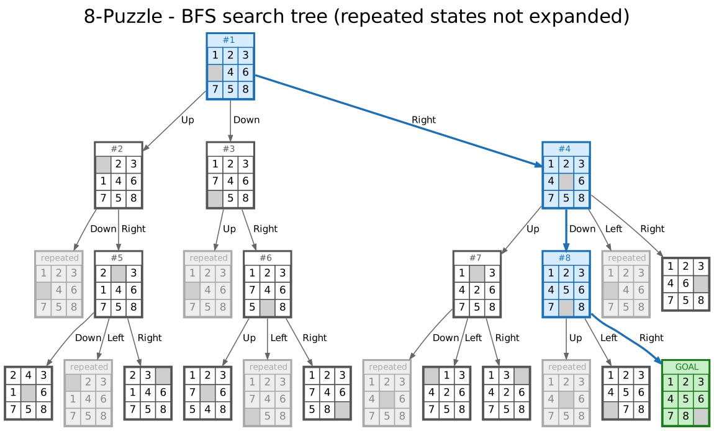
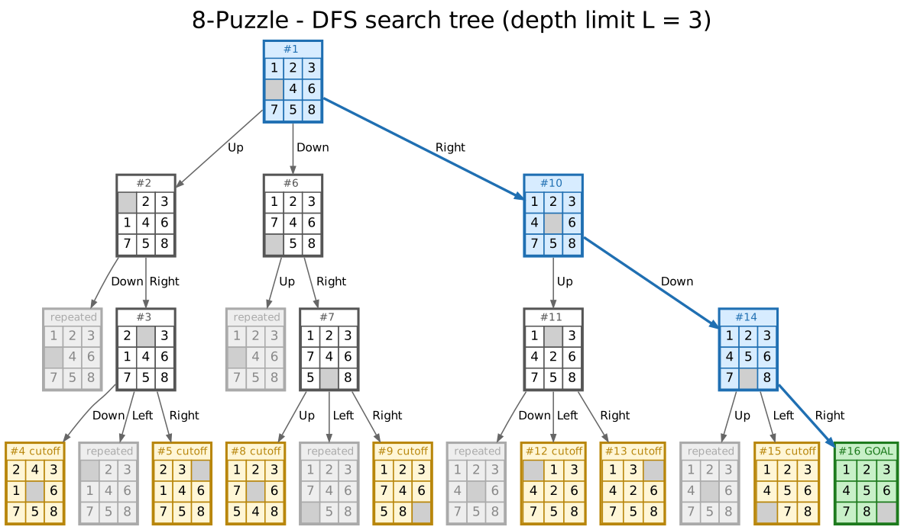
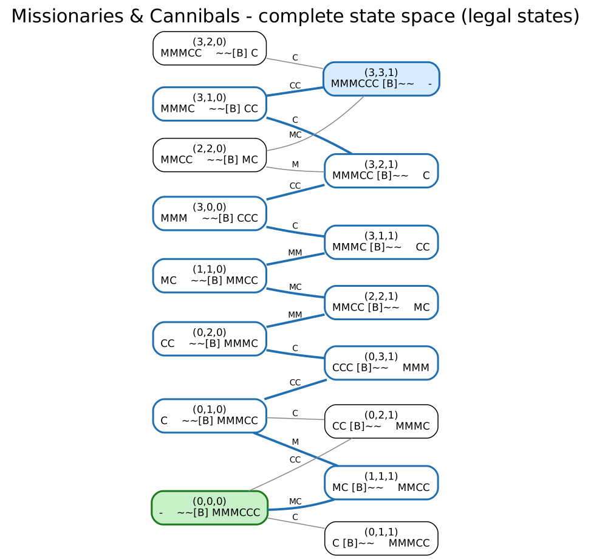
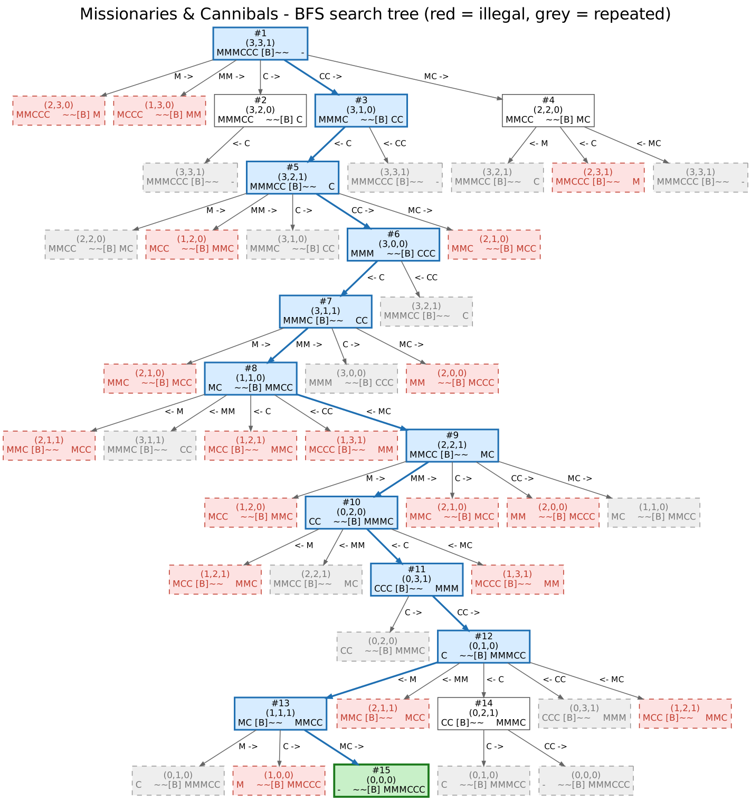
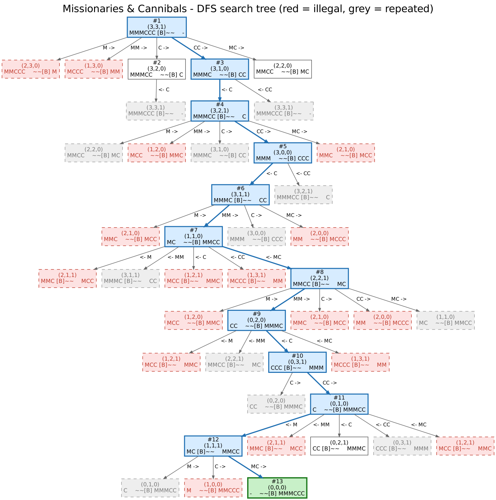
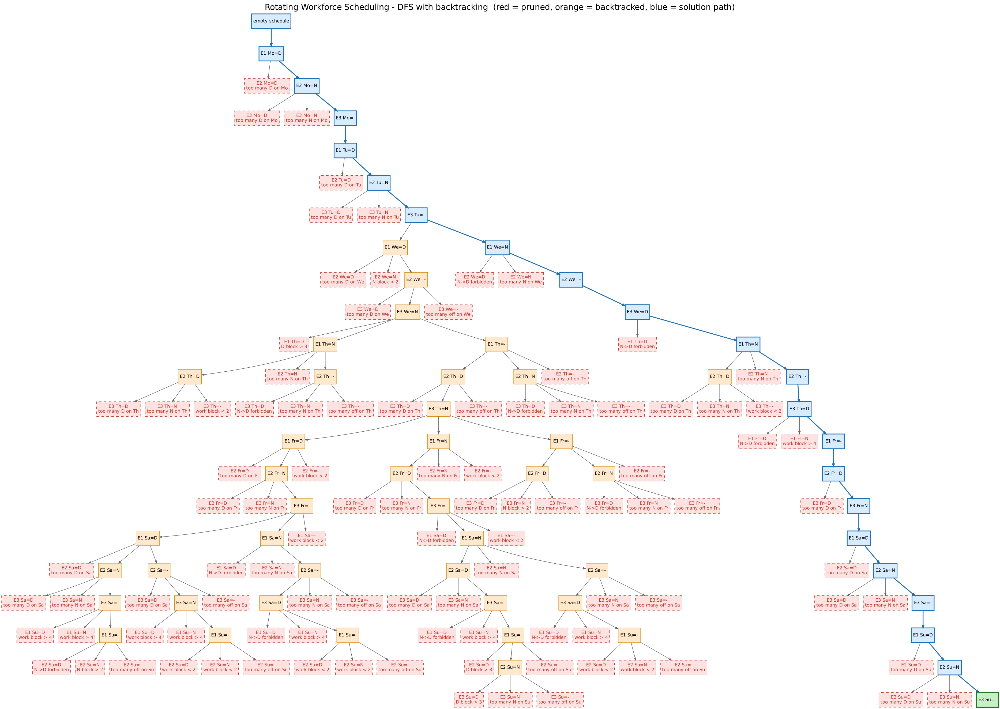

# 4. Search Trees — 8-Puzzle, Missionaries & Cannibals, Rotating Workforce Scheduling

> Construct the search tree for the problems: 8-Puzzle, Missionaries and Cannibals and Rotating Workforce Scheduling.

Every script formulates the problem, runs the search, prints the search tree as text and writes the pictures in `img/` (Graphviz `.dot` source + `.png` + `.svg`).

| File | Content |
|---|---|
| `eight_puzzle.py` | 8-Puzzle: complete tree size, BFS tree, depth-limited DFS tree |
| `missionaries_cannibals.py` | complete state space, BFS tree and DFS tree with repeated-state checking |
| `rotating_workforce.py` | small RWS instance, complete DFS tree with backtracking |
| `tree_tools.py` | `SearchTree` class (records the nodes, text output, Graphviz export) |

**Legend used in all pictures**

| Colour | Meaning |
|---|---|
| white | generated / expanded node, `#k` = order in which the node was expanded |
| blue (thick edges) | node on the solution path |
| green | goal |
| grey, dashed | repeated state — already visited, not expanded again |
| red, dashed | child violates a constraint — pruned (dead end) |
| yellow | node at the depth limit (cutoff) |
| orange | consistent node, but its sub-tree had no solution → DFS backtracked from it |

---

## 4.1 8-Puzzle

### Formulation

| | |
|---|---|
| **State** | arrangement of the 8 tiles and the blank on the 3 × 3 board (tuple of 9 numbers, 0 = blank) |
| **Initial state** | `1 2 3 / _ 4 6 / 7 5 8` (any state can be given with `--start`) |
| **Actions** | move the blank **Up, Down, Left, Right** (only if it stays on the board) |
| **Transition model** | the blank swaps places with the neighbouring tile |
| **Goal test** | `1 2 3 / 4 5 6 / 7 8 _` |
| **Path cost** | 1 per move |
| **State space** | 9! = 362,880 arrangements, of which 9!/2 = **181,440** are reachable from a given state (parity of inversions) |

### Complete search tree

Without repeated-state checking every node has 2, 3 or 4 children (blank in a corner / on an edge / in the centre). From the initial state:

| depth | 0 | 1 | 2 | 3 | 4 | 5 | 6 |
|---|---|---|---|---|---|---|---|
| nodes | 1 | 3 | 8 | 24 | 64 | 192 | 512 |

Average branching factor ≈ 2.8 → BFS/DFS cost O(b^d). A random 8-Puzzle instance needs about 22 moves on average (AIMA), so the complete tree to that depth has roughly 3^22 ≈ 3.1 · 10^10 nodes — although only 181,440 different states exist. This is why repeated states have to be detected.

### BFS search tree (repeated states are not expanded)



BFS expands level by level (`#1 … #8`), generates 24 nodes (7 repeated) and finds the optimal solution at depth 3: **Right → Down → Right** (moves of the blank).

### DFS search tree with depth limit L = 3



DFS goes deep first: the left sub-tree is explored completely (nodes at depth 3 are *cutoff*) before the right one; the goal is visited as node #16. Without a depth limit DFS can wander very deep (the state space has 181,440 states and many cycles) before it ever backtracks, so the depth limit is essential.

---

## 4.2 Missionaries and Cannibals

Three missionaries and three cannibals are on one side of a river with a boat that holds one or two people. Get everyone to the other side without ever leaving missionaries outnumbered by cannibals on either bank.

### Formulation (making only the necessary distinctions)

| | |
|---|---|
| **State** | (M, C, B): missionaries and cannibals on the **left** bank, B = 1 boat on the left, 0 on the right (the right bank follows from it) |
| **Initial state** | (3, 3, 1) |
| **Goal test** | (0, 0, 0) |
| **Actions** | the boat carries M, MM, C, CC or MC to the other bank |
| **Legal state** | 0 ≤ M, C ≤ 3 and (M = 0 or M ≥ C) and (3 − M = 0 or 3 − M ≥ 3 − C) |
| **Path cost** | 1 per crossing |

State space: 4 · 4 · 2 = **32** states, **20** legal, **16** legal and reachable from (3, 3, 1), connected by 17 (undirected) moves.

### Complete state space



The blue path is the solution; from most states there is only one legal way forward. The step people usually miss is the 6th crossing (MC goes *back* to the left bank), which looks like a step in the wrong direction.

### BFS search tree (with repeated-state checking)



### DFS search tree (with repeated-state checking)



| | generated | expanded | illegal (pruned) | repeated | solution |
|---|---|---|---|---|---|
| BFS | 49 | 15 | 18 | 16 | 11 crossings (optimal) |
| DFS | 44 | 13 | 17 | 12 | 11 crossings |

Solution (11 crossings): `CC→, ←C, CC→, ←C, MM→, ←MC, MM→, ←C, CC→, ←M, MC→`

```
(3,3,1) → (3,1,0) → (3,2,1) → (3,0,0) → (3,1,1) → (1,1,0) → (2,2,1)
        → (0,2,0) → (0,3,1) → (0,1,0) → (1,1,1) → (0,0,0)
```

---

## 4.3 Rotating Workforce Scheduling (RWS)

A **cyclic** schedule for n employees is an n × 7 table: in week 1 employee 1 works row 1, employee 2 row 2, …; every week each employee moves to the next row (after the last row comes the first one). Reading the table row by row gives one cyclic sequence of 7n days.

### General formulation

| | |
|---|---|
| **Variables** | x(i, j) — shift of row i on day j, i = 1..n, j = Mon..Sun → 7n variables |
| **Domain** | {D (day), A (afternoon), N (night), – (day off)} — the default instance uses {D, N, –} |
| **Temporal requirements** | number of employees in shift s on day j must be R(s, j) |
| **Forbidden sequences** | e.g. N → D (a day shift may not follow a night shift) |
| **Block lengths** | min/max length of work blocks, days-off blocks and blocks of the same shift — measured on the **cyclic** sequence |
| **Objective** | find a schedule that satisfies all constraints (soft constraints such as free weekends could be added) |
| **Search space** | (k+1)^(7n) for k shift types → default instance 3^21 ≈ **1.05 · 10^10** |

### Default instance (small enough to draw the whole tree)

```
employees n = 3  (cyclic schedule of 21 days)
temporal requirements: every day 1 × D and 1 × N  (so 1 employee is off)
forbidden sequence:    N -> D
work blocks 2..4, days-off blocks 1..2, shift blocks D: 1..3, N: 1..2
```

### Search tree — DFS with backtracking

Cells are filled **day by day** (E1 Mon, E2 Mon, E3 Mon, E1 Tue, …), values in the order D, N, –. After every assignment the constraints are checked on the partial schedule (unknown cells are ignored); a violating child is pruned, and when all values of a cell fail, DFS backtracks to the previous cell.



DFS generated **159** nodes: 99 children were pruned (typical reasons: *too many N on Th*, *N→D forbidden*, *work block > 4*, *work block < 2*), DFS backtracked 39 times and found:

```
Week/Row  Mo  Tu  We  Th  Fr  Sa  Su
   1       D   D   N   N   -   D   D
   2       N   N   -   -   D   N   N
   3       -   -   D   D   N   -   -

cyclic sequence: D D N N - D D N N - - D N N - - D D N - -
```

Check: every column has one D, one N and one day off; there is no N directly followed by D; work blocks have length 3–4, days-off blocks 1–2, D blocks ≤ 3 and N blocks ≤ 2 (also across the end of a row and from row 3 back to row 1).

The first wrong decision is **E1 We = D** (orange): the partial schedule is still consistent, but no completion of it satisfies all constraints. DFS only discovers this deep in the tree and has to backtrack through the whole orange sub-tree before trying **E1 We = N**, which leads to the solution — a typical example of the cost of chronological backtracking.

---

## How to run

```bash
python eight_puzzle.py                       # default start 123046758, DFS limit 3
python eight_puzzle.py --start 023145786 --limit 4   # solution depth 4
python missionaries_cannibals.py
python missionaries_cannibals.py -m 4 -c 4 --capacity 3
python rotating_workforce.py
python rotating_workforce.py --no-images     # text tree only
```

Pictures are written to `img/` when Graphviz (`dot`) is installed (`winget install graphviz` / `apt install graphviz`); otherwise only the `.dot` files are written — the pre-rendered pictures are already in `img/`.

## References

* S. Russell, P. Norvig — *Artificial Intelligence: A Modern Approach*, ch. 3 (problem formulation, 8-Puzzle, Missionaries & Cannibals).
* S. Amarel — *On representations of problems of reasoning about actions*, 1968.
* N. Musliu, J. Gärtner, W. Slany — *Efficient generation of rotating workforce schedules*, Discrete Applied Mathematics 118, 2002.
* N. Musliu — *Problem Solving and Search in AI*, slides: Basic Concepts (RWS), Uninformed Search (search trees, M&C exam question).
