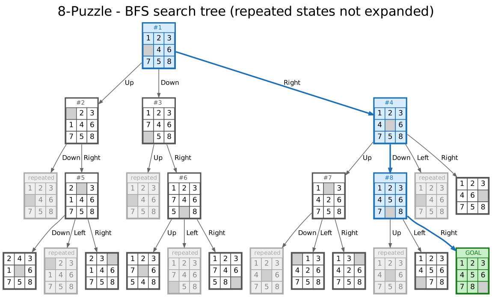
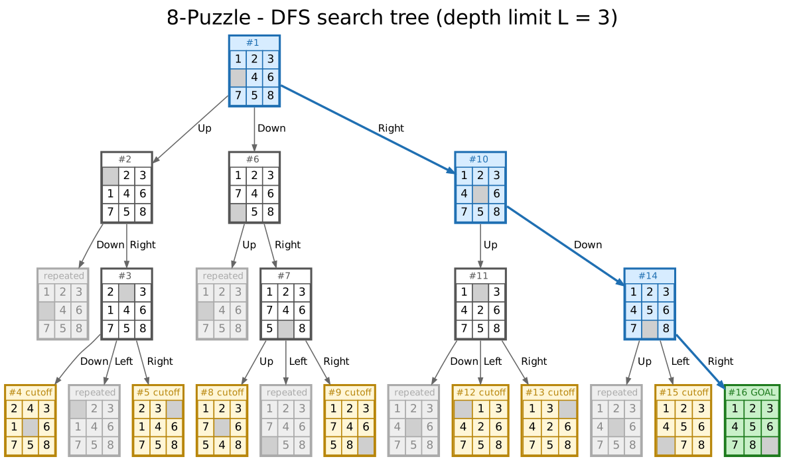
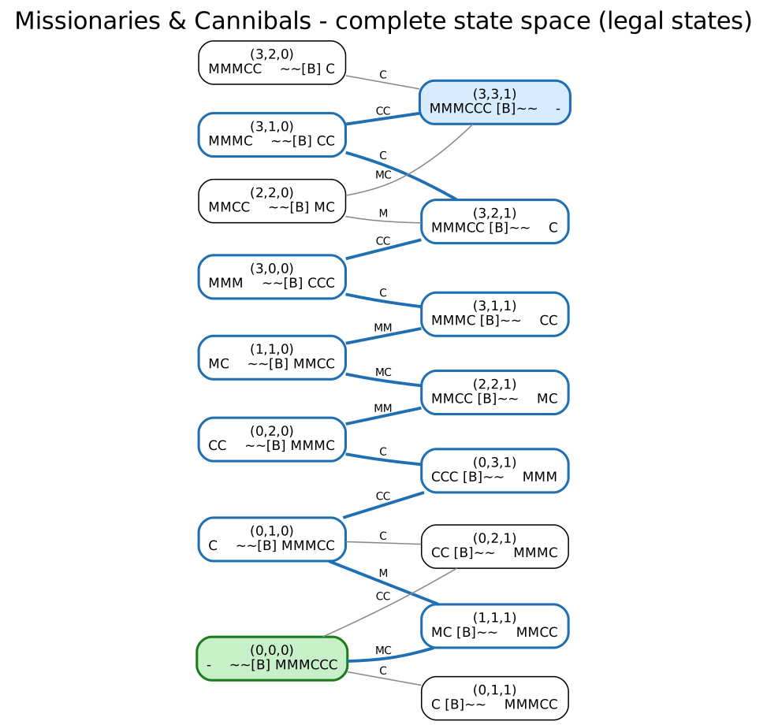
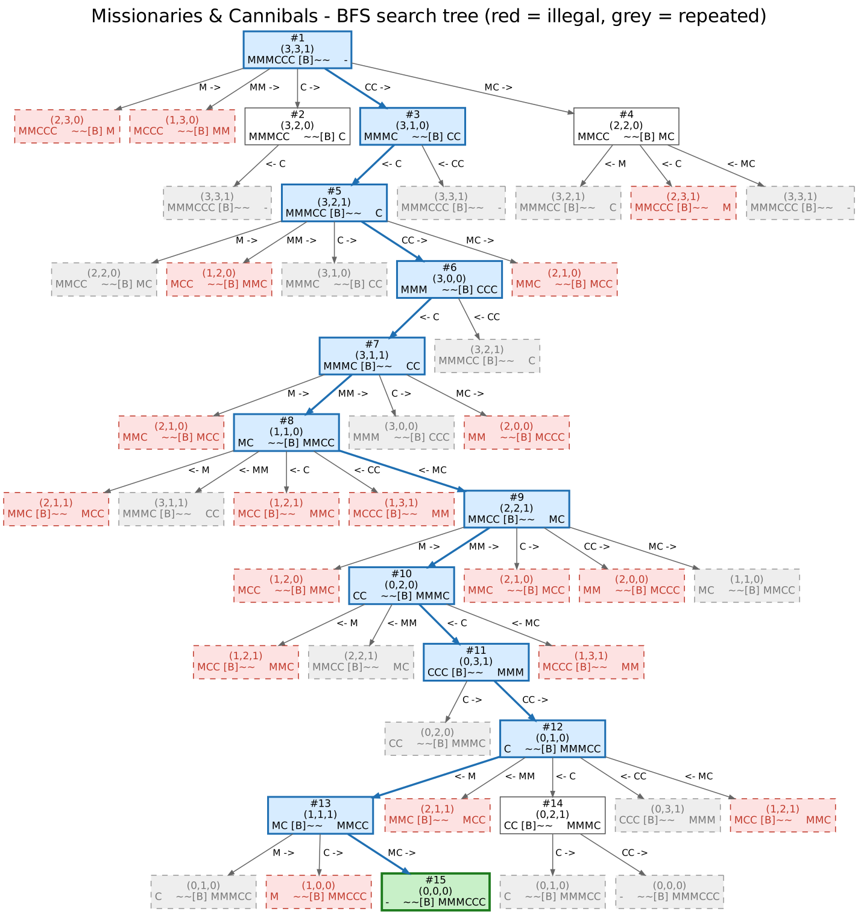
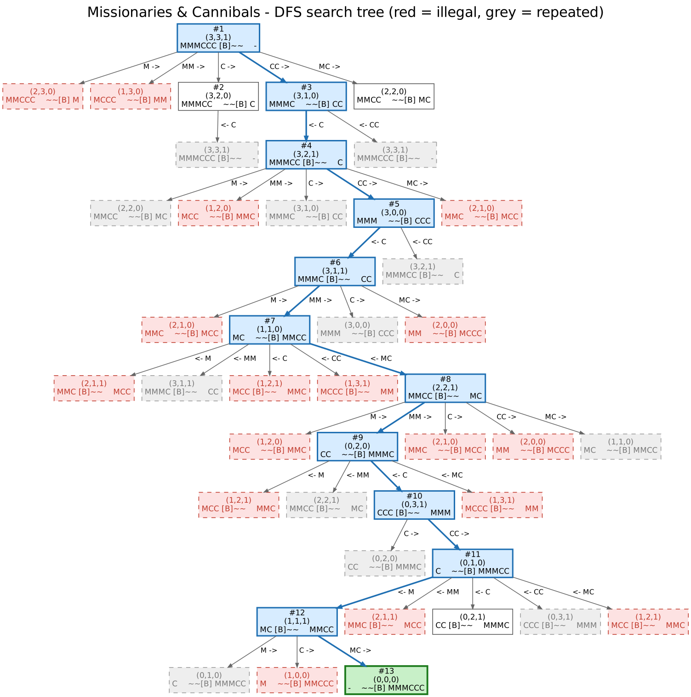
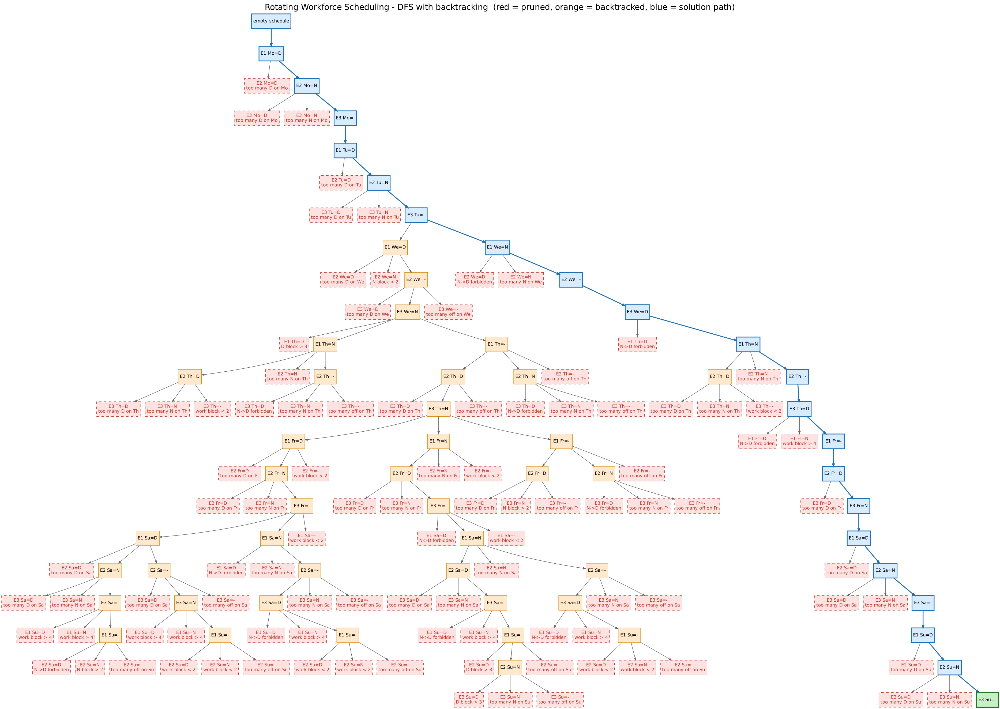

# Detyra 1 – Uninformed Search Techniques

Artificial Intelligence 2026/27, master's program
Author: Dea Llapatinca

Four problems, solved with the search algorithm the assignment asks for. For each of the first three: the model of the problem, its representation (variables, domains, constraints), the objective function, the size of the search space (landscape), the implementation and the results. The fourth part builds and draws search trees.

Everything is plain Python 3.8+, no packages needed. Graphviz (`dot`) is optional, it re-draws the pictures of part 4 (they are already in `04_search_trees/img/`).

## How to run

```
cd 01_social_golfers
python social_golfers.py                  # 32 golfers, 8 groups of 4: finds the max number of weeks
python social_golfers.py -w 9             # one run with 9 weeks
python social_golfers.py --strategy lex --max
python social_golfers.py --landscape

cd ../02_sudoku
python sudoku_bfs.py                      # easy, medium and hard puzzles
python sudoku_bfs.py --level hard --order mrv
python sudoku_bfs.py --puzzle "53..7....6..195....98....6.8...6...34..8.3..17...2...6.6....28....419..5....8..79"
python sudoku_bfs.py --generate medium --seed 7
python sudoku_bfs.py --landscape

cd ../03_latin_square
python latin_square.py 5
python latin_square.py 5 --verbose
python latin_square.py 5 --full --order cyclic    # prints exactly the example of the assignment
python latin_square.py 5 --landscape

cd ../04_search_trees
python eight_puzzle.py
python missionaries_cannibals.py
python rotating_workforce.py
```

Every script has `--help`. Times below are from a fast desktop; on a laptop expect 3-4x more.

## 1. Social Golfers – DFS with backtracking

32 golfers play once a week in 8 groups of 4. Two golfers may be in the same group only once. For how many weeks can they play?

**Model.** A schedule is a list of weeks, every week splits the 32 golfers into 8 groups of 4. Hard constraints: C1 every golfer plays exactly once per week, C2 every pair of golfers meets at most once. No soft constraints. Upper bound: each week a golfer meets 3 new people and there are 31 others, so w ≤ 31/3 = 10 weeks. 10 is known to be possible (Aguado, 2004) but very hard to find.

**Representation.** `schedule[week][group]` = list of golfers.

| | |
|---|---|
| variables | x(week, group, slot), 32·w of them |
| domain | {0, ..., 31} |
| constraints | C1: every week is a permutation of 0..31; C2: for all golfers a ≠ b, a and b share a group in at most one week |

In the code the constraints are bitmasks: `met[a]` = golfers a already played with, `used[week]` = golfers already placed that week. One AND tells if a golfer can join a group.

**Objective function.**

```
f(S) = Σ_{a<b} max(0, m_ab − 1) + Σ_w Σ_a |c_w(a) − 1|
```

m_ab = number of weeks a and b share a group, c_w(a) = how often a appears in week w. f = 0 exactly for a valid schedule. The optimisation version is: maximise w such that a schedule with f = 0 exists.

**Landscape** (`--landscape`, w = 10):

| representation | size |
|---|---|
| any golfer in any slot, 32^320 | 4.45·10^481 |
| every week a permutation, (32!)^10 | 1.59·10^354 |
| every week a partition into 8 groups of 4 | 5.37·10^197 |
| plus week 1 fixed and weeks unordered | 2.49·10^172 |

2000 random schedules have f between 140 and 186 (mean 163), none is feasible. The feasible region is a tiny island, so the search has to prune early.

**Implementation.** DFS fills the schedule position by position (week by week, group by group). A golfer is placed only if he is free this week and has not met anyone in the group; if no golfer fits, DFS goes back one position and tries the next golfer there. Symmetry breaking removes equivalent schedules: week 1 is fixed to {0,1,2,3},{4,5,6,7},...; golfers inside a group are increasing; the first golfer of a group is the smallest free one; weeks are ordered by the partner of golfer 0.

Two orders in which the children are tried (both are the same DFS):

- `lex`: one golfer per level, smallest golfer first.
- `freedom` (default): one pair per level; the pair whose members have the fewest common unmet golfers is tried first (Triska & Musliu 2012, "first fail").

**Results** (time limit 60 s per w):

| w | lex nodes | lex time | freedom nodes | freedom time |
|---|---|---|---|---|
| 2 – 5 | 32 … 128 | 0.00 s | 16 … 64 | 0.00 s |
| 6 | > 10 million | timeout | 80 | 0.005 s |
| 7, 8 | – | – | 96, 112 | 0.005 s |
| **9** | – | – | **128, 0 backtracks** | **0.005 s** |
| 10 | – | – | > 20 million | timeout |

```
         Group 1     | Group 2     | Group 3     | Group 4     | Group 5     | Group 6     | Group 7     | Group 8
Week 1   0,1,2,3     | 4,5,6,7     | 8,9,10,11   | 12,13,14,15 | 16,17,18,19 | 20,21,22,23 | 24,25,26,27 | 28,29,30,31
Week 2   0,4,8,12    | 1,5,9,13    | 2,6,10,14   | 3,7,11,15   | 16,20,24,28 | 17,21,25,29 | 18,22,26,30 | 19,23,27,31
Week 3   0,5,16,21   | 1,4,17,20   | 2,7,18,23   | 3,6,19,22   | 8,13,24,29  | 9,12,25,28  | 10,15,26,31 | 11,14,27,30
Week 4   0,6,26,28   | 1,7,27,29   | 2,4,24,30   | 3,5,25,31   | 8,14,18,20  | 9,15,19,21  | 10,12,16,22 | 11,13,17,23
Week 5   0,11,18,25  | 1,10,19,24  | 2,9,16,27   | 3,8,17,26   | 4,15,22,29  | 5,14,23,28  | 6,13,20,31  | 7,12,21,30
Week 6   0,7,10,13   | 1,6,11,12   | 2,5,8,15    | 3,4,9,14    | 16,23,26,29 | 17,22,27,28 | 18,21,24,31 | 19,20,25,30
Week 7   0,14,19,29  | 1,15,18,28  | 2,12,17,31  | 3,13,16,30  | 4,10,23,25  | 5,11,22,24  | 6,8,21,27   | 7,9,20,26
Week 8   0,15,20,27  | 1,14,21,26  | 2,13,22,25  | 3,12,23,24  | 4,11,16,31  | 5,10,17,30  | 6,9,18,29   | 7,8,19,28
Week 9   0,9,17,24   | 1,8,16,25   | 2,11,19,26  | 3,10,18,27  | 4,13,21,28  | 5,12,20,29  | 6,15,23,30  | 7,14,22,31
```

Why `lex` gets stuck at week 6: taking the smallest golfer first builds weeks 2–5 inside the halves {0..15} and {16..31}. After that, golfer 0 has met all of 1..15, and the same holds for everybody, so in week 6 a group can contain at most two golfers. The mistake was made in week 2 but DFS only notices in week 6 and has to backtrack through an enormous subtree. The `freedom` order avoids such closed blocks and finds 9 weeks without a single backtrack. 10 weeks (the optimum) is out of reach for plain backtracking; it was found with design theory and later with local search.

## 2. Sudoku – BFS with backtracking

Solve a Sudoku; the program must handle Easy, Medium and Hard puzzles.

**Model.** 9×9 grid, 27 units (rows, columns, 3×3 boxes). Given: the clues. Hard constraint: every unit contains 1..9 exactly once, clues cannot change. A proper Sudoku has exactly one solution.

The three levels are defined by the human technique needed (`puzzles.py`): Easy = naked singles are enough (a cell with one possible digit), Medium = hidden singles are also needed (a digit with one possible place in a unit), Hard = you have to guess. The bank has two puzzles per level: the Wikipedia example and Project Euler grid 01 (easy), two generated ones (medium), AI Escargot and Everest by A. Inkala (hard). `--generate` makes new puzzles of any level.

**Representation.** A string of 81 characters row by row, `.` = empty.

| | |
|---|---|
| variables | x(r, c) for every empty cell |
| domain | {1..9} minus the digits already in the cell's row, column and box |
| constraints | all-different for every row, column and box |

A node of the search tree is a partial grid, a child fills one more cell, every goal is at depth e = number of empty cells.

**Objective function.** f(G) = Σ over the 27 units of (9 − number of different digits) + number of changed clues. f = 0 ⇔ solved.

**Landscape** (`--landscape`): a full grid has 9^81 ≈ 2·10^77 fillings, 6.67·10^21 of them are valid Sudokus. Per puzzle:

| puzzle | empty | 9^e | rows as permutations | digits allowed by clues |
|---|---|---|---|---|
| easy-1 | 51 | 4.6·10^48 | 2.4·10^23 | 4.3·10^22 |
| medium-1 | 56 | 2.7·10^53 | 3.0·10^27 | 4.4·10^31 |
| hard-2 Everest | 60 | 1.8·10^57 | 7.0·10^30 | 9.6·10^36 |

Random grids have f ≈ 45–50; exactly one point has f = 0.

**Implementation.** A FIFO queue holds partial grids. Take the oldest grid, find its first empty cell, create one child per digit that does not clash with the row, column and box (clashing digits are never created, that is the backtracking), put the children at the back. A grid whose empty cell has no digit left is dropped. Stop when a grid has no empty cell. `--order mrv` fills the cell with the fewest candidates first instead of the first empty cell.

**Results:**

| puzzle | level | depth | generated nodes | max queue size | time | with MRV: nodes / queue |
|---|---|---|---|---|---|---|
| easy-1 | easy | 51 | 4,632 | 738 | 0.005 s | 52 / 1 |
| easy-2 | easy | 49 | 929 | 146 | 0.001 s | 50 / 1 |
| medium-1 | medium | 56 | 36,239 | 7,862 | 0.04 s | 147 / 5 |
| medium-2 | medium | 55 | 21,433 | 5,184 | 0.02 s | 445 / 17 |
| hard-1 Escargot | hard | 58 | 18,885 | 1,716 | 0.02 s | 2,425 / 96 |
| hard-2 Everest | hard | 60 | 2,068,781 | 356,812 | 2.3 s | 24,881 / 1,003 |

All puzzles are solved with f = 0 and `--all` confirms each has one solution. Every solution lies at the deepest level, so BFS has to generate the whole consistent tree first; for Everest it keeps 356,812 grids in memory at once – the typical weakness of BFS. With MRV the easy puzzles need no branching at all (every step has one candidate), which is exactly the naked-single technique.

## 3. Latin Square – IDDFS with backtracking

Given n, print an n×n grid with 1..n exactly once in every row and column.

**Model.** n² cells, values 1..n, rows and columns all-different. A Latin square exists for every n (for example the cyclic one, x(r,c) = (c − r) mod n + 1); the task is to construct one by search.

**Representation.** `grid[r][c]`.

| | |
|---|---|
| variables | x(r, c), n² of them |
| domain | {1..n} |
| constraints | all-different per row and per column |

Cells are filled row by row, every solution is at depth n². Reduced form (default): first row and column are fixed to 1..n – every Latin square can be renamed into that form, so only (n−1)² cells are searched. `--full` searches all cells.

**Objective function.** f(X) = Σ_rows (n − different values) + Σ_cols (n − different values) = number of repeated values. f = 0 ⇔ Latin square.

**Landscape** (`--landscape`):

| | n = 5 | n = 6 |
|---|---|---|
| any value in any cell, n^(n²) | 2.98·10^17 | 1.03·10^28 |
| rows as permutations, (n!)^n | 2.49·10^10 | 1.39·10^17 |
| reduced form, ((n−1)!)^(n−1) | 331,776 | 2.49·10^10 |
| number of Latin squares L(n) | 161,280 | 8.13·10^8 |

**Implementation.** A depth limited DFS (`dls`) fills one cell per level, tries only values not yet in the row or column and backtracks when a cell has no value left. It returns SOLUTION, CUTOFF (some branch hit the limit) or FAILURE (whole tree explored). `iddfs` calls it with limit L = 0, 1, 2, ... until the result is not CUTOFF. `--order cyclic` tries the value of the cyclic square first; `--algo dfs` runs a plain DFS for comparison.

**Results** (reduced form):

| n | depth | IDDFS nodes | time | full grid nodes |
|---|---|---|---|---|
| 3 | 4 | 19 | 0.000 s | 326 |
| 4 | 9 | 161 | 0.000 s | 24,861 |
| 5 | 16 | 4,914 | 0.003 s | 13,505,923 (10–45 s) |
| 6 | 25 | 1,194,077 | 1–4 s | timeout |
| 7 | 36 | > 30 million | timeout | timeout |

For n = 5 the iterations L = 0..15 visit 1, 5, 14, 28, 39, 64, 125, 201, 247, 323, 433, 569, 625, 681, 737, 793 nodes and all end in CUTOFF; the last iteration finds the square after 29 nodes. So 4,885 of the 4,914 nodes are the price of iterative deepening. Plain DFS (`--algo dfs`) needs 29 nodes, and with the cyclic order it never backtracks: n = 50 in 2,501 nodes.

Lesson: IDDFS is the right tool when the goal may be shallow (it is optimal like BFS with the memory of DFS). Here every solution is at the maximum depth, so every iteration before the last is wasted work, and the number of partial Latin squares grows so fast that n = 7 is already out of reach.

Output of `python latin_square.py 5`:

```
1 2 3 4 5
2 1 4 5 3
3 4 5 1 2
4 5 2 3 1
5 3 1 2 4

objective f = 0 (0 = Latin square)
iterations = 17  (last limit L = 16, nodes in last iteration = 29)
nodes visited = 4,914
```

## 4. Search trees

The three scripts print the tree as text and draw it with Graphviz into `04_search_trees/img/`. Colours: white = expanded node (`#k` = order of expansion), blue = solution path, green = goal, grey dashed = repeated state, red dashed = violates a constraint (pruned), yellow = depth limit, orange = DFS backtracked from it.

### 8-Puzzle

State = the board (9 numbers, 0 = blank), actions = move the blank up/down/left/right, goal = `1 2 3 / 4 5 6 / 7 8 _`, cost 1 per move. 9!/2 = 181,440 reachable states. The complete tree from the start `1 2 3 / _ 4 6 / 7 5 8` has 1, 3, 8, 24, 64, 192, 512 nodes at depths 0–6 (branching factor ≈ 2.8).

BFS (repeated states not expanded) generates 24 nodes and finds the solution at depth 3: Right → Down → Right. DFS with depth limit 3 visits 16 nodes before it reaches the goal.




### Missionaries and Cannibals

State (M, C, B) = missionaries and cannibals on the left bank and the side of the boat; start (3,3,1), goal (0,0,0); the boat carries M, MM, C, CC or MC. A state is illegal if on either bank 0 < missionaries < cannibals. 32 states, 20 legal, 16 reachable.



| | generated | expanded | illegal | repeated | solution |
|---|---|---|---|---|---|
| BFS | 49 | 15 | 18 | 16 | 11 crossings |
| DFS | 44 | 13 | 17 | 12 | 11 crossings |

Solution: CC→, ←C, CC→, ←C, MM→, ←MC, MM→, ←C, CC→, ←M, MC→.




### Rotating Workforce Scheduling

A cyclic schedule for n employees is an n×7 table; every week an employee moves to the next row, so the table read row by row is one cyclic sequence of 7n days. Instance: 3 employees, shifts D and N, every day one D and one N, N→D forbidden, work blocks 2–4 days, off blocks 1–2 days, D blocks ≤ 3, N blocks ≤ 2.

Variables x(i, j) = shift of row i on day j, domain {D, N, –}, 3^21 ≈ 10^10 tables. DFS fills the cells day by day with D, N, –; after every cell the constraints are checked on the partial table, a value that breaks one is pruned, when all three fail DFS backtracks. 160 nodes, 99 pruned, 39 backtracks:

```
Week/Row  Mo  Tu  We  Th  Fr  Sa  Su
   1       D   D   N   N   -   D   D
   2       N   N   -   -   D   N   N
   3       -   -   D   D   N   -   -
```



The first wrong decision is E1 We = D (orange): the partial table is still fine but nothing below it works, and DFS only finds out deep in the tree.

## Files

```
01_social_golfers/social_golfers.py
02_sudoku/sudoku_bfs.py, puzzles.py
03_latin_square/latin_square.py
04_search_trees/eight_puzzle.py, missionaries_cannibals.py, rotating_workforce.py, tree_tools.py, img/
```

## Literature

- S. Russell, P. Norvig – Artificial Intelligence: A Modern Approach, ch. 3.
- Z. Michalewicz, D. B. Fogel – How to Solve It: Modern Heuristics, ch. 1–3.
- N. Musliu – Problem Solving and Search in AI (slides: Basic Concepts, Uninformed Search).
- M. Triska, N. Musliu – An effective greedy heuristic for the Social Golfer Problem, Annals of OR 194, 2012.
- CSPLib problem 010 (Social Golfers); OEIS A000315 (reduced Latin squares); B. Felgenhauer, F. Jarvis – Enumerating possible Sudoku grids, 2005.
